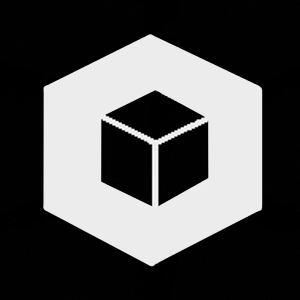

# Holocron - XWing Tournament Software

## Description

Holocron is a tournament management program for X-Wing Miniatures. Easily 
generate pairings, track scores, and determine winners with our user-friendly 
interface. Perfect for tournament organizers looking to streamline their events.
Holocron is a tournament software built with JDK 27 with the use of jlink and
jpackage to produce native executables for Windows, Linux, and MacOS.

## Features
- Swiss tournament support
- 2.5 tournament [rule](https://www.atomicmassgames.com/xwing-documents) support
- Export Tournaments to [ListFortress](https://listfortress.com/)

## Installation

Native distributions can be found in the 
[releases](https://github.com/PiecePaperCode/holocron/releases) section of this 
repository. Simply download the appropriate executable for your operating system 
and run it.

## Building

Holocron requires JDK 27 and Maven. Set `JAVA_HOME` to your JDK 27 installation
(and select JDK 27 as the project SDK and Maven runner JDK in IntelliJ).
Run `mvn clean verify` to run the tests and create a jar with all dependencies.
On Linux, `xvfb-run -a mvn clean verify` also runs the JavaFX application smoke
test when a physical display is unavailable.

Run the app with `mvn javafx:run`, or run the packaged jar with
`java --enable-native-access=ALL-UNNAMED -jar target/holocron-0.1-SNAPSHOT.jar`.

The build uses Kotlin 2.4.21 and JavaFX 27.0.1. Java and Kotlin both target
Java 26 bytecode, the highest target supported by stable Kotlin 2.4, while
building and running on JDK 27.

## Future Plans

I plan to introduce more features to Holocron in the future, such as support 
for additional tournament rules and the ability to customize tournaments. 
Stay tuned! 

Discuss it on 
[Join Discord](https://discord.gg/y8Npbe9T6q)
