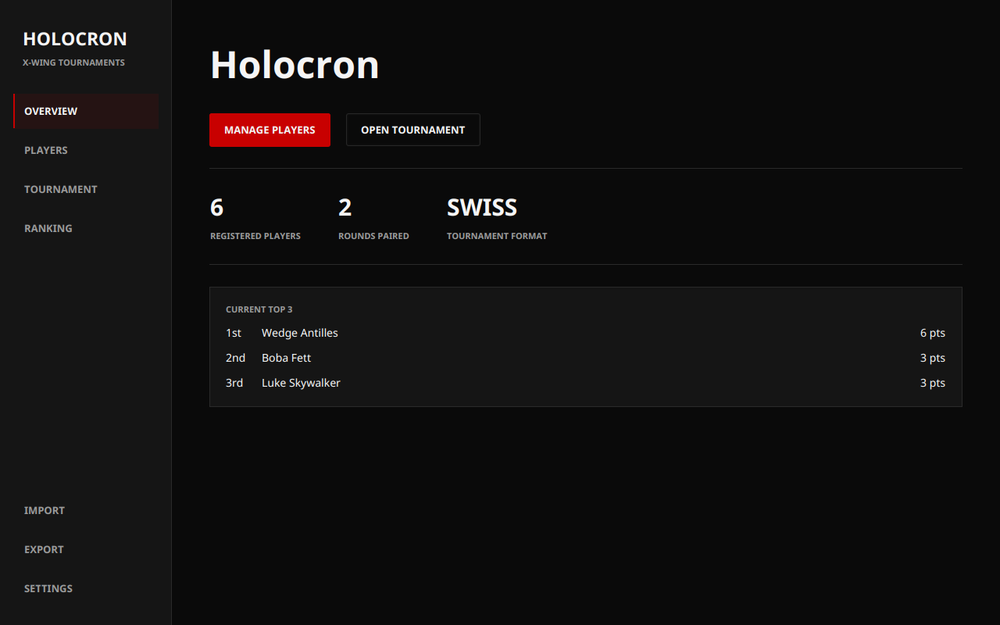
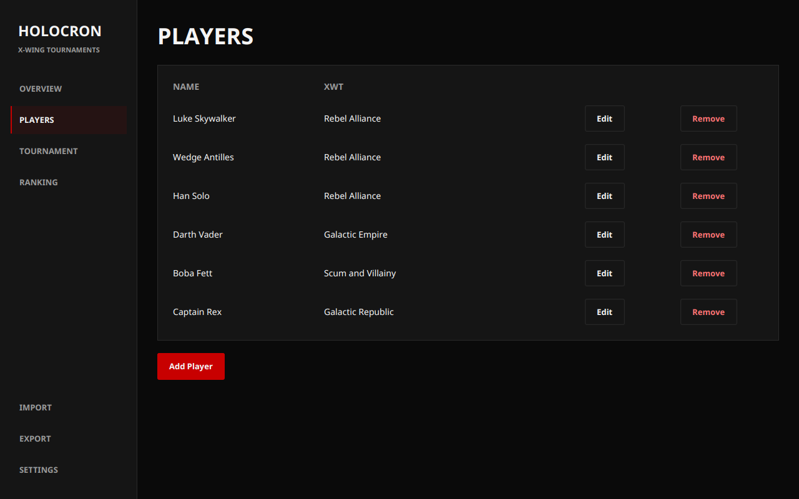
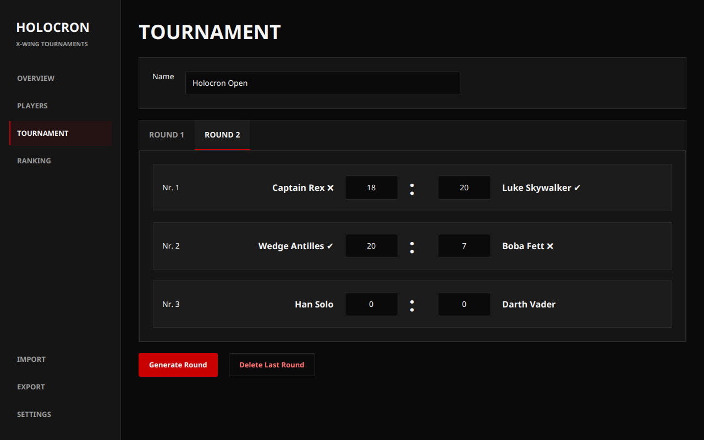
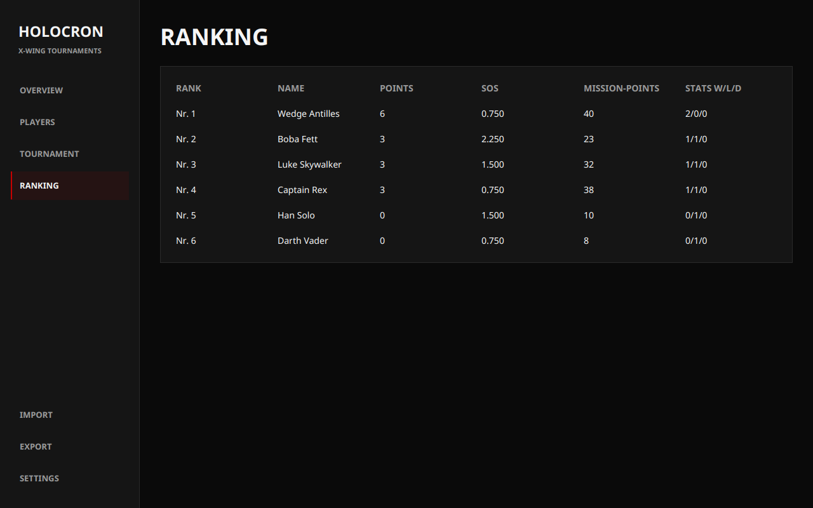
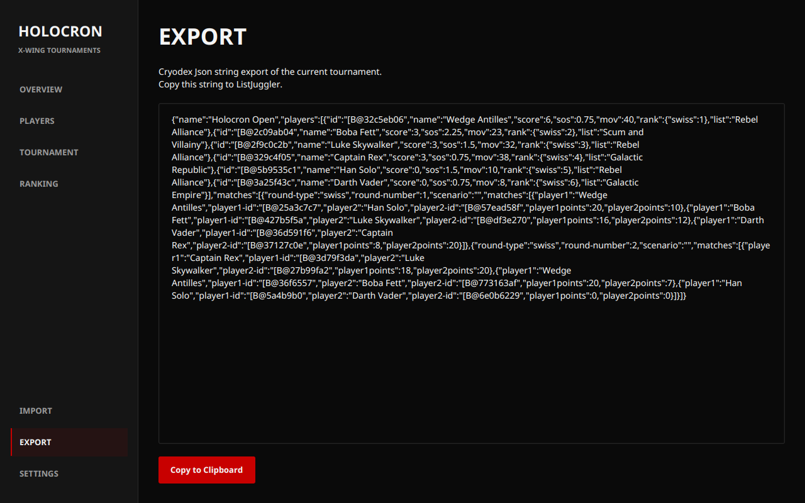

# Holocron - X-Wing Tournament Software

Holocron is a desktop app for running X-Wing Miniatures tournaments. Manage
players, generate Swiss pairings, enter scores, and follow the standings.

The home screen puts player and round counts alongside quick actions. When
standings are available, it also shows the current top three players and their
points.

## Screenshots

These screenshots show the current design with a sample six-player tournament.

| Players | Tournament |
| :---: | :---: |
|  |  |
| Manage players and squad lists. | Switch rounds and enter match scores. |
| **Ranking** | **Export** |
|  |  |
| Follow points, tiebreakers, and match records. | Copy tournament data as JSON. |

## Features
- Swiss tournament support
- 2.5 tournament [rule](https://www.atomicmassgames.com/xwing-documents) support
- Export Tournaments to [ListFortress](https://listfortress.com/)

## Installation

Native distributions can be found in the 
[releases](https://github.com/PiecePaperCode/holocron/releases) section of this 
repository. Simply download the appropriate executable for your operating system 
and run it.

## Building

Holocron requires JDK 26 and Maven. Set `JAVA_HOME` to your JDK 26 installation
(and select JDK 26 as the project SDK and Maven runner JDK in IntelliJ).
Run `mvn clean verify` to run the tests and create a jar with all dependencies.
On Linux, `xvfb-run -a mvn clean verify` also runs the JavaFX application smoke
test when a physical display is unavailable.

Run the app with `mvn javafx:run`, or run the packaged jar with
`java --enable-native-access=ALL-UNNAMED -jar target/holocron-0.1-SNAPSHOT.jar`.

The build uses Kotlin 2.4.21 and JavaFX 26.0.1. Java and Kotlin both target
Java 26 bytecode, the highest target supported by stable Kotlin 2.4, while
building and running on JDK 26.

## Future Plans

I plan to introduce more features to Holocron in the future, such as support
for additional tournament rules and the ability to customize tournaments.
Stay tuned!

Discuss it on
[Join Discord](https://discord.gg/y8Npbe9T6q)
